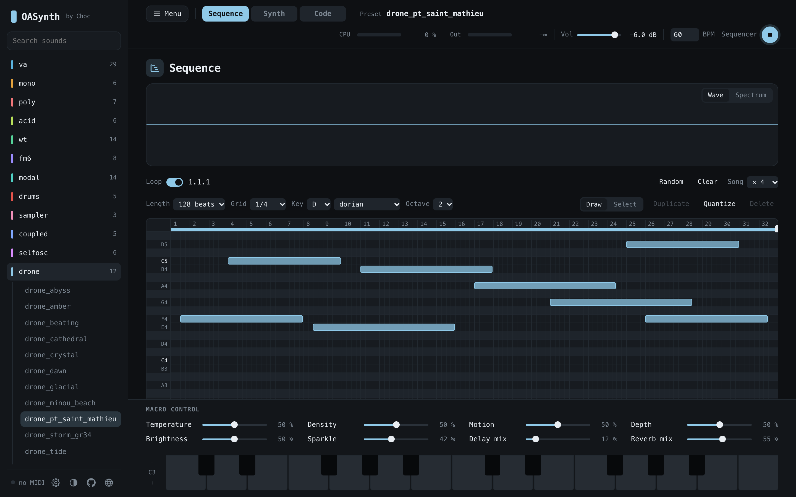
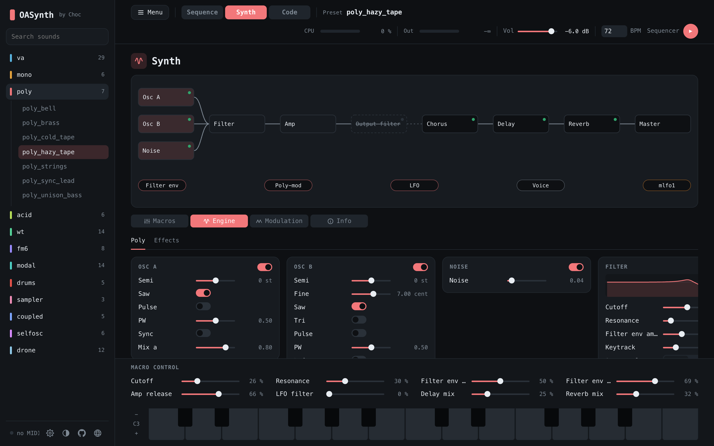
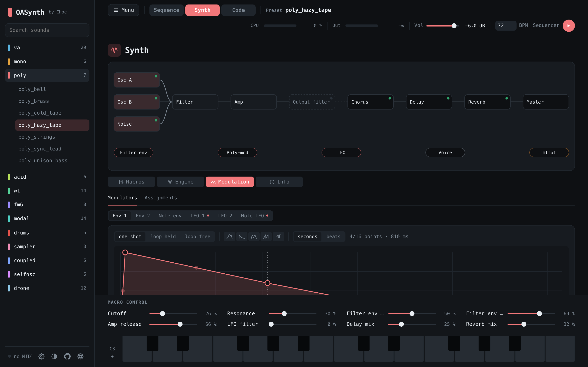
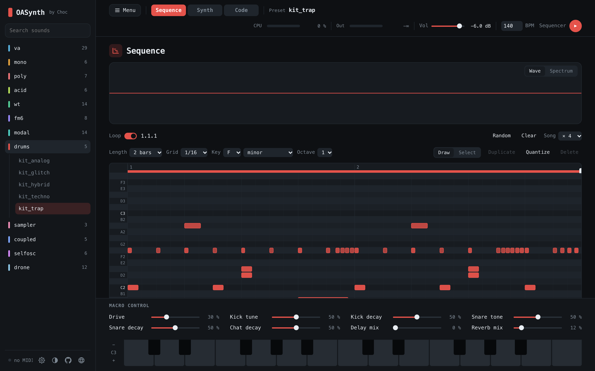
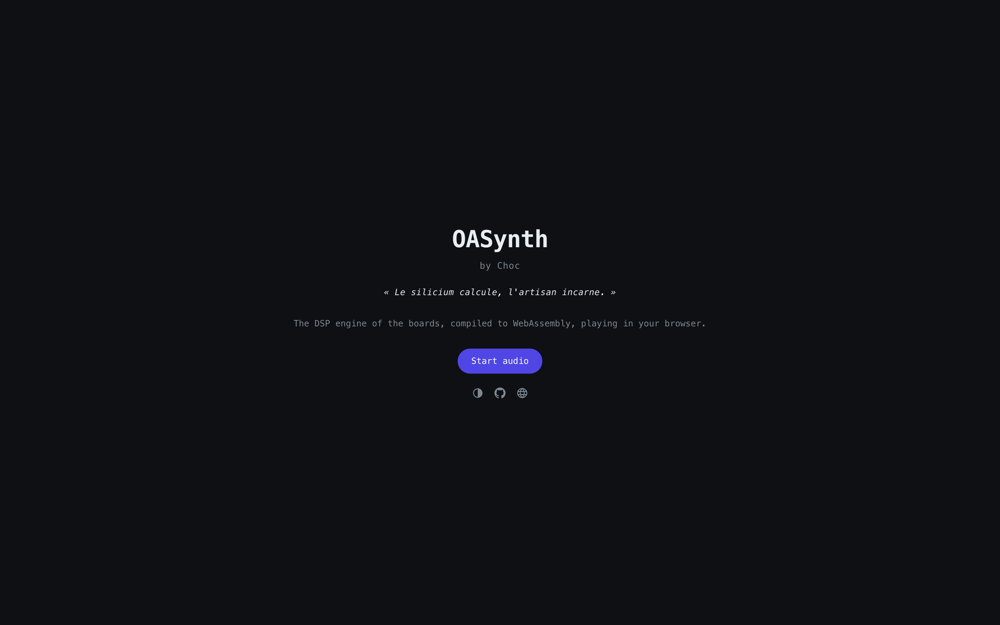
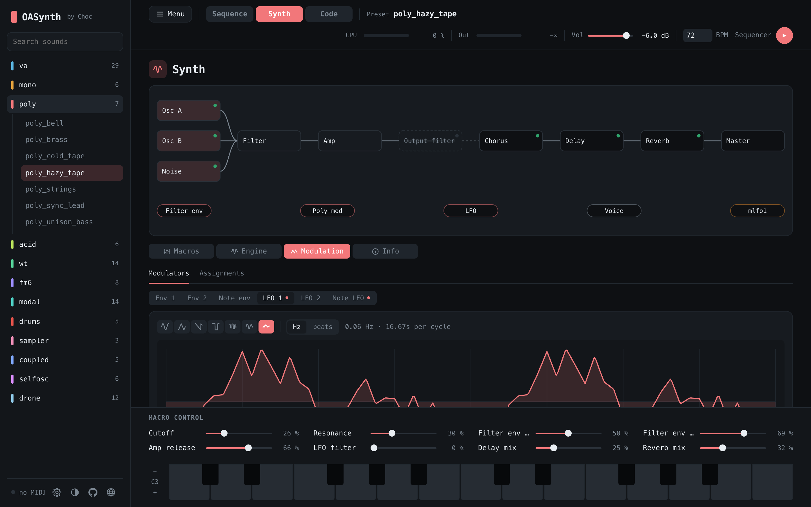
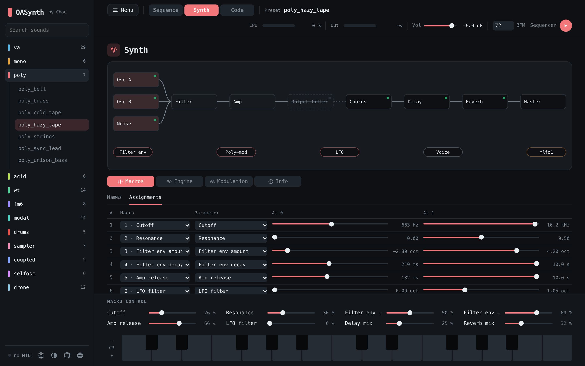
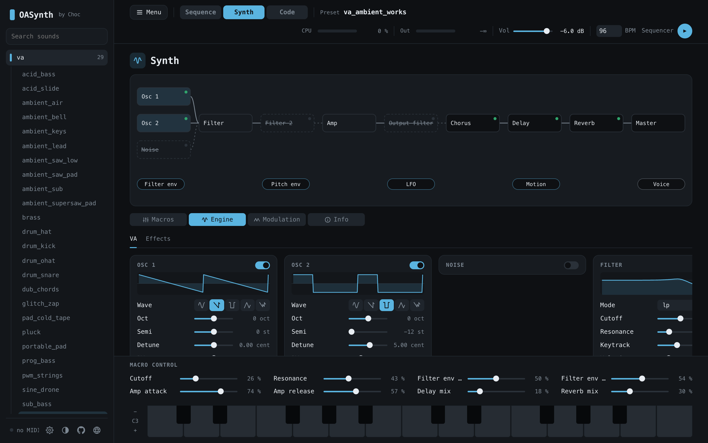
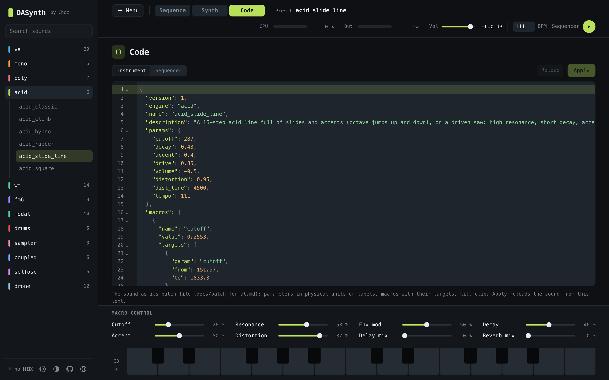

# OASynth by Choc

**[Play it in your browser](https://vincentchoqueuse.github.io/openaudiosynth/)** · [Source on GitHub](https://github.com/vincentchoqueuse/openaudiosynth) · by Vincent Choqueuse, [vchoqueuse.fr](https://vchoqueuse.fr)

A portable synthesizer engine in plain C11, written to **sound good** first and to run anywhere: a Mac, a web page,
a DAW, and STM32 boards. One DSP core, several thin hosts.

```
                ┌── host/     macOS: live play (CoreAudio + CoreMIDI), WAV renders, tools
dsp/ + midi/ ───┼── web/      browser: wasm + AudioWorklet + Svelte UI
(C11, no deps)  ├── plugin/   CLAP plugin, one plugin per engine
                └── target/   STM32H745 / STM32F746 firmware (in progress)
```

## Screenshots

The web version, dark theme. Each link opens the same sound in your browser.


*Sequence: [drone_pt_saint_mathieu](https://vincentchoqueuse.github.io/openaudiosynth/?sound=drone_pt_saint_mathieu), the live display above its piano roll, the
macros above the keyboard.*


*Synth: the signal chain of [poly_hazy_tape](https://vincentchoqueuse.github.io/openaudiosynth/?sound=poly_hazy_tape&view=synth) (a click on a block opens its
settings), then the instrument's cards in the order the signal flows.*


*Modulation: a multi-segment envelope, dragged point by point, with a playhead while it runs.*


*[kit_trap](https://vincentchoqueuse.github.io/openaudiosynth/?sound=kit_trap): a melodic bass drum that slides between held notes, triplet hi-hat rolls.*

<details>
<summary>More: the opening screen, LFO, macros, the VA engine, the code editor</summary>







</details>

## Engines

| Engine | In the spirit of |
|---|---|
| `va` | a two-oscillator virtual analog: noise, two filters in series or parallel (SVF, ladder, formant, screaming 2-pole), two envelopes, two LFOs, supersaw |
| `mono` | the classic three-oscillator monosynth panel: free-running oscillators, overloading mixer with output feedback, 24 dB ladder, ADS contours, modulation mix, note priority, glide |
| `acid` | the early-80s transistor bass line: 18 dB ladder, accent, slide |
| `poly` | the late-70s programmable polysynth: two oscillators with sync, 24 dB ladder, poly-mod, unison |
| `fm4` | four-operator phase modulation on a free matrix: any operator modulates any other and itself, an output level each; the classic algorithms are one click; ADSR per operator, pitch envelope, filter |
| `flux` | a feedback noise machine: eight coupled channels of oscillator and regulated feedback delay (wavefolder, filter, crackle), slow drift; from deep atmospheres to harsh noise |
| `fm6` | six-operator phase modulation: 32 algorithms, rate/level envelopes, keyboard scaling, feedback, sysex bank import |
| `wt` | a modern wavetable synth: morphing tables, unison, warps, SVF / ladder / comb / formant filters |
| `modal` | banks of damped resonators (strings, bars, bells, membranes, tubes) and a physical piano |
| `drums` | a synthesized drum machine: analog, hybrid, glitch and trap kits, plus a melodic bass drum that slides between held notes |
| `sampler` | a drum sampler: kits of your own samples, 16 pads with speed, start/end points, reverse, loop, filter, choke groups; band-limited playback |
| `coupled` | networks of coupled Stuart-Landau oscillators |
| `selfosc` | self-oscillating Van der Pol / Duffing oscillators driven by the note |
| `drone` | a drone machine: wandering partials, a body, breath and sparkles, from glacial to warm |

Every part has 8 macros, 2 tempo-syncable LFOs, 2 looping multi-segment envelopes (MSEG) and 8 modulation routes;
per-note MSEG and LFO, MPE, microtuning (Scala), 8 multitimbral parts, MIDI clock, and an effect bus (phaser,
flanger, chorus, tape delay, plate reverb, freeze), then the master: level, saturation, DC blocker, look-ahead limiter and a soft
clipper. The full parameter list is
[docs/catalog.md](docs/catalog.md).

## Sound quality

- Band-limited oscillators (polyBLEP / polyBLAMP, mipmapped wavetables).
- Zero-delay-feedback (TPT) filters, stable under fast modulation.
- Nonlinear filters oversampled 1x / 2x / 4x (a per-engine `oversample` setting, polyphase half-band).
- Exponential analog-style envelopes, click-free voice stealing, parameter smoothing, slow per-voice drift.
- Every patch and song has an audio fingerprint (`tests/golden.json`): a refactoring cannot change the sound
  unnoticed.

## Built for small machines

- `float` only, no allocation after init, no libm call per sample, block processing (32 samples).
- `dsp/` depends on nothing but `<stdint.h>`, `<stddef.h>` and `<math.h>` (tables at init).
- One public header, [dsp/synth.h](dsp/synth.h), with one handle per instance:

```c
#include "synth.h"

synth_t *s = synth_default();             /* or synth_create(mem, synth_size(), sr) */
synth_init(s, 48000.0f);
synth_set_engine(s, SYNTH_ENGINE_MONO);
synth_midi(s, (const uint8_t[]){0x90, 48, 100}, 3, 0);   /* note-on, sample offset 0 */
synth_render(s, left, right, 256);        /* any size, split into blocks of 32 */
```

See [examples/minimal.c](examples/minimal.c) and the API index [docs/api.md](docs/api.md).

## Build (macOS, Apple Silicon)

Requirements: CMake 3.25+, [just](https://github.com/casey/just), Python 3. Optional: Node (web UI),
emscripten (`brew install emscripten`, wasm), the Arm GNU Toolchain (STM32 builds).

```sh
just setup                 # Python venv, npm, configure every preset whose toolchain is installed
just test                  # build, then unit tests, code rules, audio fingerprints, plugin test
just render mono_d_bass    # render a patch to build-host/renders/ and play it
just song duel_froid       # render a song
just play mono             # play live with a USB MIDI controller (or the computer keyboard)
just web                   # browser prototype on http://localhost:5173
just plugin-install        # install OASynth.clap in ~/Library/Audio/Plug-Ins/CLAP
just check                 # everything: host, Debug, ASan, ARM, wasm
```

## Open formats

Patches, songs and controller maps are plain JSON described by schemas in [spec/](spec/) (format OID 0.3): a patch
names an engine and its parameters in physical units (Hz, seconds, dB, semitones). The same file plays on the Mac,
in the browser, in the plugin and on the boards. 88 patches are in [patches/](patches/), songs in [songs/](songs/).

## Layout

| Folder | Content |
|---|---|
| `dsp/` | the engine: `core`, `osc`, `filter`, `env`, `mod`, `fx`, `voice`, `engines`, `synth.h` |
| `midi/` | USB-MIDI packets and DIN byte stream parsing |
| `host/` | macOS player, renderer, catalog, sysex import, JSON patches and songs |
| `web/` | wasm build and the Svelte UI ([web/README.md](web/README.md)) |
| `plugin/` | the CLAP plugin and its test host ([plugin/README.md](plugin/README.md)) |
| `tests/` | unit suites, benchmark, audio fingerprints |
| `tools/` | Python: analysis, plots, validation, code rules, generators |
| `docs/` | [architecture](docs/architecture.md), [decisions](docs/decisions.md), [bench](docs/bench.md), [adding an engine](docs/adding_an_engine.md) |

## Status

Done: the engines above, modulation, multitimbral parts, effects, web UI, CLAP plugin. In progress: the STM32H745
port (audio on the M7 through SAI and DMA), then the F746. See [docs/progress.md](docs/progress.md).

## Credits and license

Implemented from the DSP literature and public documentation: V. Zavalishin (*The Art of VA Filter Design*),
Välimäki et al. (polyBLEP), A. Huovilainen (nonlinear ladder), J. Chowning (FM), W. Pirkle, and the public
DX7 sysex format. No third-party synthesizer code, no factory sounds or samples: every patch is original, and the
sysex importer reads banks you provide. Product names in the documentation only describe the inspiration.

MIT license, see [LICENSE](LICENSE). Third-party parts keep their own licenses:

- `third_party/clap`: the CLAP headers (MIT, their authors);
- `target/h745`: the files generated by STM32CubeMX and ST's templates (BSD-3-Clause, one Apache-2.0), listed in
  [target/h745/LICENSE-ST.md](target/h745/LICENSE-ST.md); ST's HAL and drivers are not in the repository;
- the board's screen font is rasterized from DejaVu Sans ([third_party/fonts/LICENSE_DEJAVU](third_party/fonts/LICENSE_DEJAVU));
- the web UI's npm dependencies (Svelte, Vite, CodeMirror: MIT) are installed by npm, not stored here.

The web page loads nothing from third parties (no web fonts, no analytics, no cookies). Product names in the
documentation only describe an inspiration or a compatible format; they belong to their owners.
